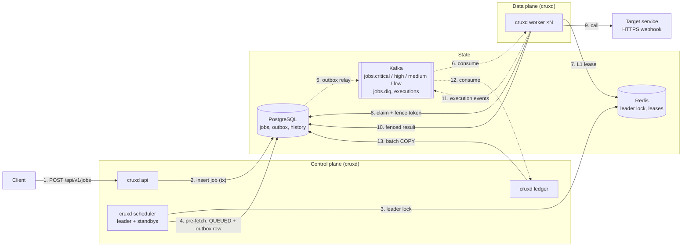

# Cruxd

A distributed job scheduler written in Go. Cruxd runs one-time and cron jobs across many nodes, delivers each job to an HTTPS endpoint, and keeps working when any node crashes.

> **Status:** early development, Phase 0 of 14 (project skeleton). The architecture below is the planned design. Each part will be built and tested in turn.

## Design goals

- **At-least-once execution.** A job may run more than once, but it is never silently lost.
- **Effectively-once at the target.** Every call carries an `Idempotency-Key` (`job_id:scheduled_for`) and an `X-Fence-Token`, so the receiving service can drop duplicates and stale calls.
- **No in-memory-only state.** Any node can be killed at any moment. Job state lives in PostgreSQL, and dispatch goes through Kafka.
- **Low trigger jitter.** Target: a job starts within 5 s of its scheduled time at p99, under load.

## Planned architecture



Solid arrows are direct calls. Dashed arrows go through Kafka.

### How a job flows

1. A client submits a job over HTTPS with an `Idempotency-Key`. A retried request returns the same job instead of creating a second one.
2. The API stores the job in PostgreSQL in one transaction.
3. One scheduler node holds the leader lock in Redis. A term number issued by PostgreSQL is checked on every leader write, so a paused old leader can't cause damage.
4. The leader finds jobs that are about to be due (`FOR UPDATE SKIP LOCKED`), marks them `QUEUED` and writes an outbox row in the same transaction.
5. A relay publishes outbox rows to a Kafka topic per priority. Writing to the outbox avoids a dual write to PostgreSQL and Kafka.
6. Workers consume from a Kafka consumer group with a bounded pool.
7. A short Redis lease filters out concurrent duplicate deliveries.
8. The authoritative claim happens in PostgreSQL and returns a **fence token** that increases on every claim.
9. The worker calls the target with the fence token and idempotency key, and heartbeats its lease while the call runs.
10. The result is written only if the fence token still matches (`WHERE id = $1 AND fence_token = $2`). A worker whose lease expired changes nothing.
11. The worker publishes an execution event to Kafka.
12. The ledger reads execution events in batches.
13. The ledger bulk-loads them into day-partitioned PostgreSQL tables (`COPY` plus `ON CONFLICT DO NOTHING`).

Failed jobs retry with exponential backoff and jitter, then move to a dead-letter topic after the last attempt.

## Tech stack

| Area | Choice |
|---|---|
| Language | Go |
| Source of truth | PostgreSQL 16 (`pgx/v5`) |
| Dispatch and event log | Apache Kafka in KRaft mode (`franz-go`) |
| Locks, leases, rate limits | Redis 7 (`go-redis`) |
| Cron parsing | `robfig/cron/v3` (parser only) |
| Logging | `log/slog`, JSON |
| Metrics and tracing | Prometheus, Grafana, OpenTelemetry |
| Local environment | docker-compose |

## Roadmap

- [ ] 0. Foundations and local infrastructure
- [ ] 1. Job store
- [ ] 2. API service
- [ ] 3. Leader election
- [ ] 4. Scheduler pre-fetch and outbox
- [ ] 5. Outbox relay to Kafka
- [ ] 6. Worker core
- [ ] 7. Worker crash safety
- [ ] 8. Retries, dead-letter queue, poison jobs
- [ ] 9. Recurring jobs and notifications
- [ ] 10. Execution ledger
- [ ] 11. Priority and fairness
- [ ] 12. Observability
- [ ] 13. Chaos and load testing
- [ ] 14. Deployment

## Running locally

```sh
go run ./cmd/cruxd
```

Setup with docker-compose (PostgreSQL, Kafka, Redis) and a Makefile is part of Phase 0 and coming next.
